# CalendarTimeTracker

**CalendarTimeTracker** is a Streamlit (Python) app for analyzing how time is spent across multiple public `.ics` calendar URLs. It focuses on **event duration** rather than content and supports both **calendar-based** and **category-based** visualizations.

## 🚀 Features

- 📅 Load multiple calendars from `calendars.txt` or `calendars.json`
- 📊 Visualize total and relative time spent per day, week, or month
- 🔥 Activity heatmap (weekday × hour)
- 🔮 Upcoming weeks: hours already booked for this week and the next 3, compared with a typical week
- 🍰 Pie chart for calendar/category time distribution
- 📦 Summary tables with CSV export (includes averages per day/week)
- 🔄 Dynamically switch between viewing by **Calendar** or **Category**
- 🎨 Custom calendar colors
- 🔍 Search page: Find calendar events by name with detailed views and metrics
- 👥 Social Analysis page: Analyze who you spend the most time with
- Compare Periods page: side-by-side comparison of two date ranges with delta metrics
- 🎯 Goals page: weekly or monthly time targets per calendar or category, with streaks and hit rate
- 🗓️ Weekly Review page: one-screen review of a week vs your usual weeks, with goals, next week's load and Markdown export
- 📈 Trends page: visualize calendar activity over time using an interactive line chart
- 🧠 AI Insights page: Calendar AI Insights (ChatGPT-Powered) with day/week/month time grouping
- 📂 Import ICS page: Upload and import `.ics` files into existing calendars
- 🏷️ Tags page: counts, trends and weekday / time-of-day patterns for tag calendars such as Oura tags
- ⚙️ Settings page: edit calendars, set counting, display and Tags page defaults, manage the event cache, and edit the config files as text
- 🌍 Time zone normalization support
- ⚖️ **Data accuracy**: choose whether all-day / multi-day events count, and spot overlapping (double-counted) events
- ⚡ **Cache-first loading** with instant page loads from local cache
- 🔄 **Background auto-refresh** syncs calendars every 24 hours automatically
- 💾 **Dual loading controls**: Quick Load (cache) and Sync Calendars (URLs) on every page
- 💫 Improved user experience with progress spinners and cache management

## 🏠 Home Dashboard

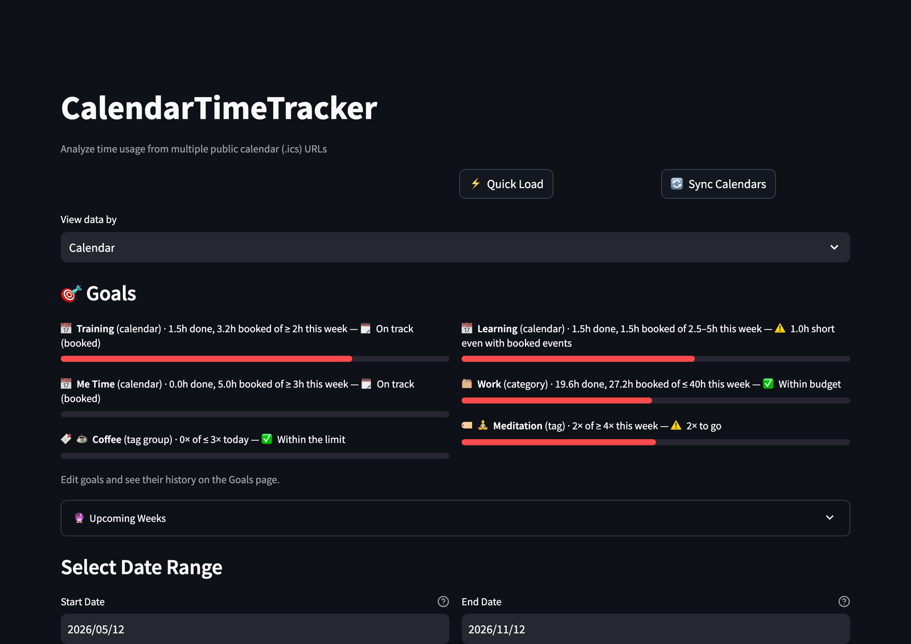

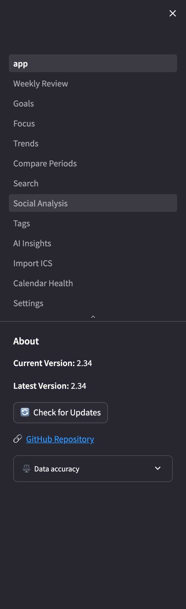

**🔮 Upcoming Weeks**: Home shows the hours already booked for this week and the next three weeks per calendar or category, next to your typical week (average of the last 8 complete weeks). Weeks above 120% of typical are flagged so you can rebalance before they happen. Future calendars are usually incomplete, so this is "booked so far", not a prediction.

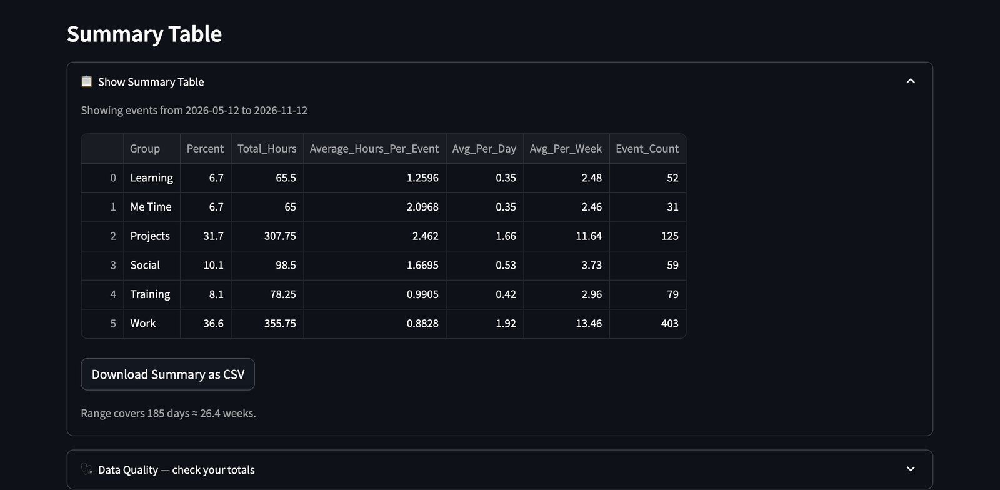

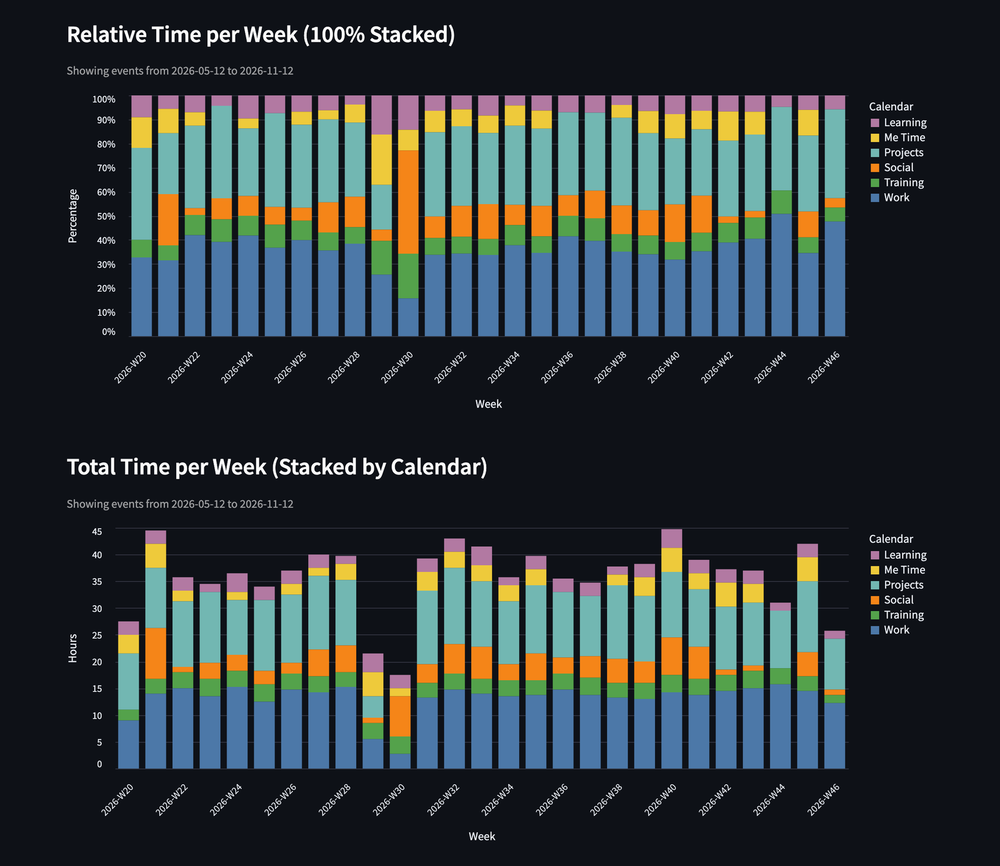

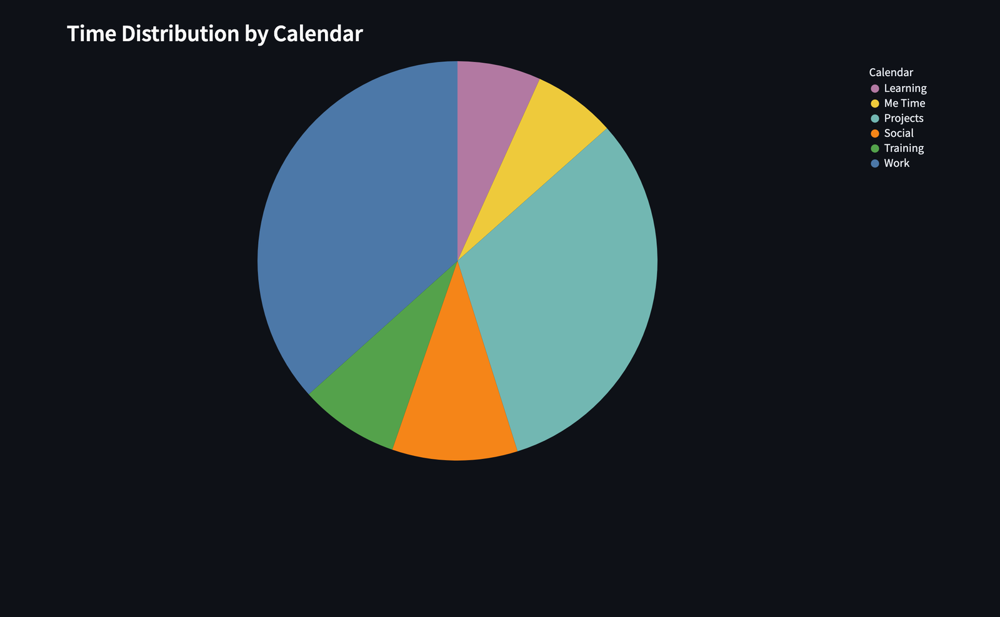

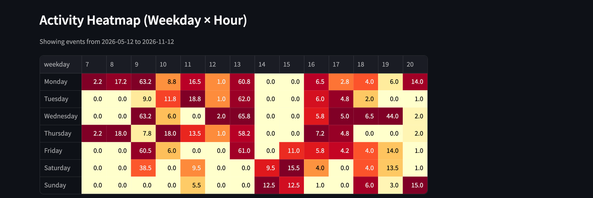

---

## ⚖️ Data Accuracy

A 3-day trip stored as one event counts as 72 hours, and the same meeting in two calendars counts twice. Both quietly inflate every chart.

- **⚖️ Data accuracy** (sidebar on Home, Compare Periods, Trends and AI Insights): count all-day and multi-day events fully, or exclude them. Events longer than a configurable number of hours (default 16) also count as long. The choice is stored in `app_settings.json` and applies to every page.
- **Ignore events marked as free** (⚖️ Data accuracy and Settings → Data & display): leaves out events whose availability is "Free" (iCal `TRANSP:TRANSPARENT`) on every page. Run 🔄 Sync Calendars once after updating so the cache records which events are free.
- **🩺 Data Quality** (Home): lists long events in the selected range, overlapping events grouped by calendar pair, and the total double-counted hours.
- Events that straddle the edge of a selected range only count with their in-range part on every page, not just in the Home summary table.

---

## ⚡ Performance Enhancements

CalendarTimeTracker v2.0 introduces major performance improvements:

### 🚀 Smart Caching Architecture
- **Cache-First Loading**: Pages load instantly from local CSV cache
- **Background Auto-Refresh**: Calendars sync automatically every 24 hours
- **24-Hour TTL**: Data stays fresh with automatic cache invalidation
- **Shared Cache**: All pages benefit from synced calendar data

### 🔄 New Loading Controls
- **⚡ Quick Load**: Load instantly from local cache
- **🔄 Sync Calendars**: Fetch latest data from calendar URLs. Syncs all calendars by default; Settings → 💾 Cache & sync can limit it to the calendars the page shows (Home always syncs all)
- **Consistent UI**: Same button layout across all pages

### 📊 Optimized Data Processing
- **Vectorized Chart Calculations**: Duration charts render ~12x faster using pandas vectorized operations
- **Progressive Loading**: Data is loaded and processed in stages with visual feedback
- **Memory Efficiency**: Better session state management reduces memory footprint
- **Faster Navigation**: Cached results enable quicker page transitions

---

## 🔍 Search Events

Find calendar events by name with detailed views and metrics.

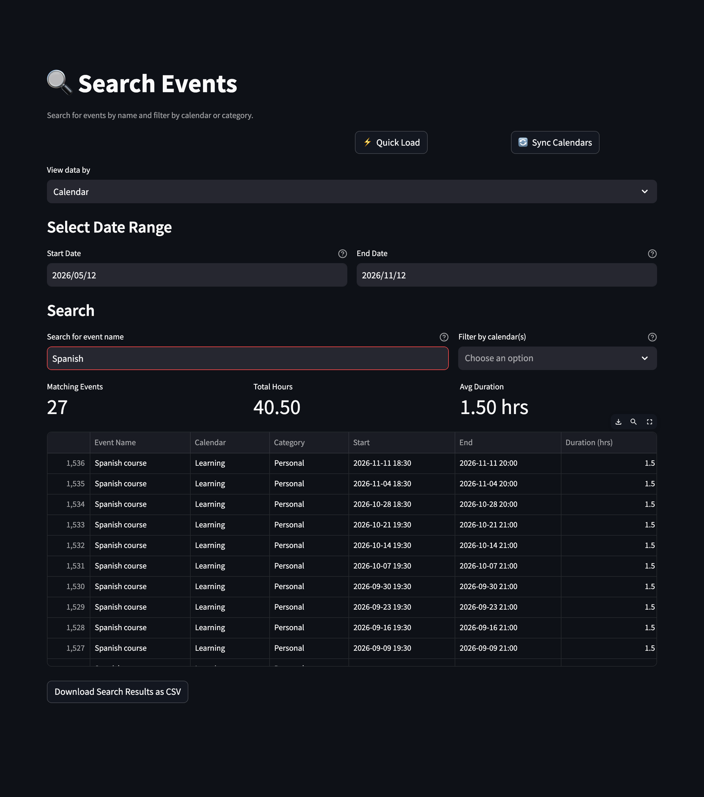

- **Dedicated Search Page**: Access via the sidebar navigation
- **Date Range Filtering**: Select month range to limit search scope
- **Search by Name**: Case-insensitive, partial match search for events
- **View Matching Events**: See all occurrences with start/end times and duration
- **Summary Metrics**: Get total matching events, total hours, and average duration
- **CSV Download**: Download search results as CSV for external analysis
- **Calendar/Category Filter**: Optionally filter search results by calendar or category (based on selected view mode)

---

### 👥 Social Time Analysis

Analyze who you spend the most time with based on calendar event titles.

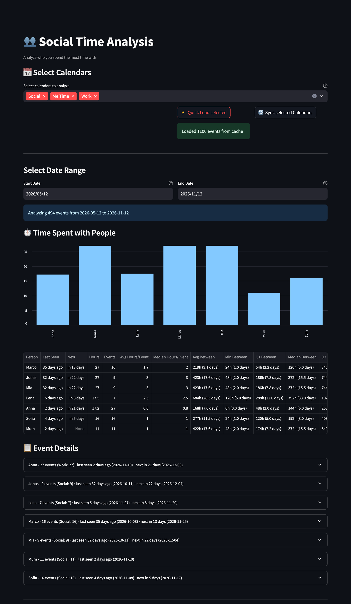

- **Track People**: Add names to track and see total hours spent with each person
- **Aliases/Nicknames**: Add comma-separated aliases (e.g., "Niclas, Nic") to group variations
- **Discover Names**: Automatically find frequently occurring words in your events
- **Date Filtering**: Analyze specific time periods with month/year selectors
- **Event Details**: See all events for each tracked person (sorted A-Z)
- **Statistics**: View hours, event count, average and median duration per person
- **Meeting Cadence**: See the time between consecutive events with each person as a five-number summary (avg, min, Q1, median, Q3, max), shown in hours with days in parentheses
- **Last Seen**: Track when you last met with each person
- **Ignore Partial Names**: Prevent "john" from matching events with "john doe" when both are tracked
- **Calendars Named After a Person**: If a calendar's name matches a tracked person or one of their aliases, every event in it counts towards them - events whose title also names them are still counted once
- **Exclude Patterns**: Filter out generic events like "team meeting" or "community time"
- **Hide from Discover**: Hide irrelevant words from the discovery list without excluding events
- **Quick Add**: Add a person by hand without editing the sidebar list
- **Sample Events**: Review events that no tracked person matched, to spot names you are still missing
- **Persistent Settings**: All configurations saved to `social_analysis_settings.json` (sorted alphabetically)

---

### 🎯 Goals

Set time targets and see whether you're living the week you intended.

- **Min / Max targets**: e.g. "Sport ≥ 4h per week" or "Work ≤ 45h per week", per calendar or category
- **Weekly or monthly**: weeks run Monday–Sunday
- **Done vs booked**: hours already passed this period, plus events still scheduled, with a status (reached, on track, behind, over budget)
- **History**: bar chart of past periods (met / missed) with the target lines, current streak and hit rate
- **Home page**: progress bars for every goal at the top
- **Editable in the app**: pick from one list where every entry shows whether it is a 📅 calendar or a 🗂️ category, so goals for a calendar and a category with the same name can't be mixed up. Goals are stored in `goals.json`

---

### 🗓️ Weekly Review

A one-screen weekly ritual instead of comparing four pages by eye.

- **Week picker**: defaults to last complete week; the current week is marked as in progress
- **Headline metrics**: total hours vs the average of the previous 4, 8 or 12 weeks, event count, busiest day, latest finish and evenings past 21:00
- **Hours by calendar/category** vs your usual week, with the biggest changes called out
- **Weekly goals**: status of every weekly goal for that week
- **Day by day**: stacked hours per day
- **Next week**: hours already booked compared with a typical week
- **Markdown export**: download the review (aggregates only, no event titles)

---

### Compare Periods

Compare your time spending between two date ranges side by side.

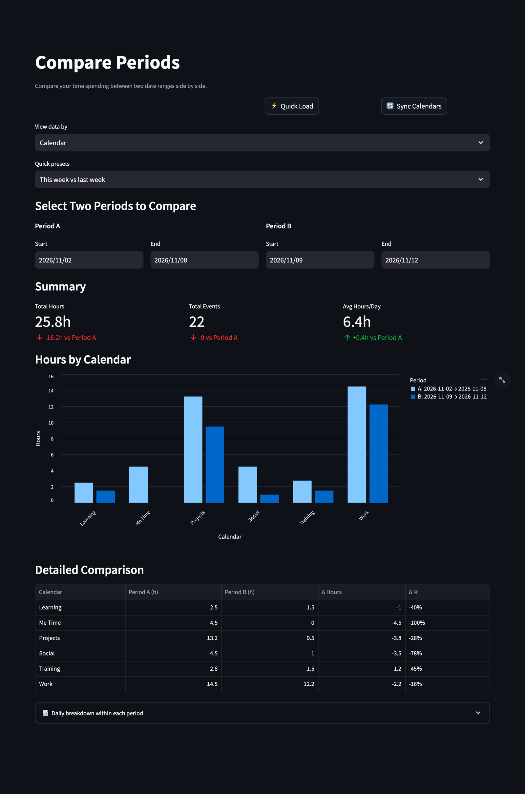

- **Quick Presets**: "This week vs last week", "This month vs last month", "This month vs same month last year", or custom ranges
- **Summary Metrics**: Total hours, total events, and average hours/day with deltas
- **Side-by-Side Bar Chart**: Grouped comparison by calendar or category
- **Detailed Comparison Table**: Absolute and percentage changes per calendar/category
- **Daily Breakdown**: Line chart of daily hours within each period

---

### 📈 Calendar Trends Overview

Understand how your calendar activity evolves over time.

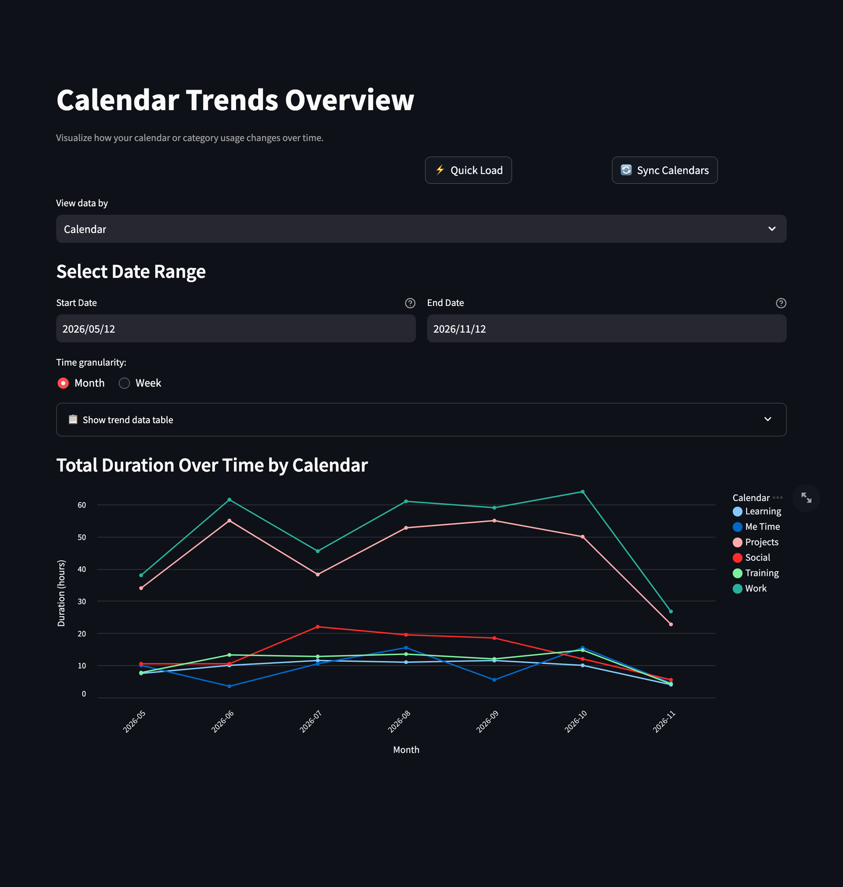

- Switch between weekly and monthly granularity
- Interactive line chart of total duration per calendar or category
- Expandable table with the underlying per-period totals
- Useful for spotting workload peaks and recurring patterns

---

### 🧠 Calendar AI Insights (ChatGPT-Powered)

Get intelligent analysis of your calendar data with AI-powered insights.

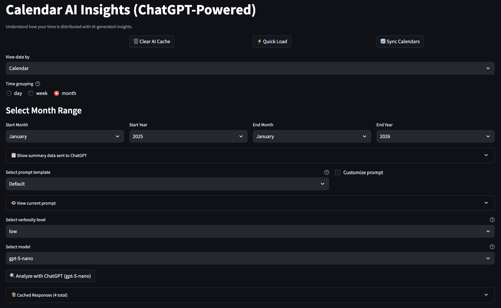

- **Time Grouping**: Analyze patterns by day, week, or month
- **Temporal Analysis**: Identify trends and patterns over time periods
- **Smart Insights**: AI provides recommendations for time management and workload optimization
- **Customizable Prompts**: Modify the AI assistant behavior to focus on specific aspects
- **Multiple Models**: Choose from different GPT model variants for analysis depth
- **Verbosity Levels**: Pick low, medium, or high detail for the generated analysis
- **Persistent Response Cache**: Results are saved to disk, survive restarts, and earlier analyses stay browsable

---

### 📂 Import ICS File

Upload `.ics` files and assign them to specific calendars configured via `calendars.json` or `calendars.txt`.

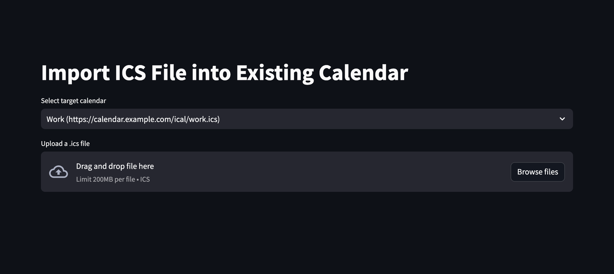

---

### 🏷️ Tags

Count markers from [tag calendars](#tag-calendars), such as Oura tags exported with [oura-tags-ical](https://github.com/ramhee98/oura-tags-ical) (☕ Coffee, 🍺 Beer, 🧖 Sauna).

- **Summary per tag**: total, average per week, days with the tag and share of days, last seen, days since last (the current streak without it, e.g. 12 alcohol-free days) and the longest gap in the range, with CSV export
- **Trend**: counts per day, week or month for the selected tags
- **Weekday pattern**: which days a tag is logged on
- **Time of day**: when timed tags happen (e.g. coffee after 14:00); all-day tags have no time and are left out
- Monthly "📊 Tag Summary" events from oura-tags-ical are ignored, and a multi-day tag counts once, on its first day
- **🗂️ Tag groups**: combine tags, e.g. every coffee type into ☕ Coffee or 🍷 Wine and 🍺 Beer into Alcohol. Pick member tags and/or add keywords that match tag names exactly, ignoring case and the emoji (`Flat White` matches ☕️ Flat White but not ☕️ Decaf Flat White). A keyword that is just an emoji, like `☕`, matches every tag starting with it, including coffee types you log in the future. **💡 Suggest from emojis** creates one group per emoji shared by several tags. **🔤 Suggest from names** creates one group per word or phrase shared by several tag names (e.g. Decaf, Flat White), with the matching tag names as keywords. A tag may be in several groups (e.g. Coffee and Decaf) and counts in each. Show groups with the remaining single tags, groups only, or single tags only. Groups are stored in `tag_groups.json`
- **Your defaults** (Settings → 🏷️ Tags): which tags or groups the charts start with (the N most frequent, 8 by default, or a fixed list), keeping your chart selection when you switch view or date range, the initial view and "Count per", a separate date range, preselected tag calendars, hidden tags, and merging tags that differ only in the emoji variant (☕ / ☕️)

---

### ⚙️ Settings

Manage the app from the browser: forms for the common settings, plus a raw text editor for every config file.

- **📅 Calendars**: add, edit and remove calendars in `calendars.json` (URL, name, type, category, color) with validation for missing or duplicate URLs, Google Calendar sharing links and invalid colors. The previous file is kept as `calendars.json.bak`, and keys added by hand are preserved. A URL tester checks that a link returns a valid iCal feed. Setups that still use `calendars.txt` can be converted in one click.
- **📊 Data & display**: how all-day and multi-day events are counted, plus the default "View data by" choice and default date range used when a page opens. Stored in `app_settings.json`.
- **🏷️ Tags**: defaults for the Tags page (see the 🏷️ Tags section above). Also stored in `app_settings.json`.
- **💾 Cache & sync**: cached events, date range and last update per calendar; sync one or all calendars, clear one calendar's cache, and delete cache files left behind by removed calendars, individually or all at once. Also choose whether 🔄 Sync Calendars on a page fetches all calendars (default) or only those the page shows (tag calendars on the Tags page, time calendars on the other pages). Home always syncs all calendars.
- **📝 Raw files**: edit `calendars.json`, `calendars.txt`, `app_settings.json`, `goals.json`, `tag_groups.json`, `social_analysis_settings.json` and `ai_config.json` as text. JSON is checked before saving, the previous version is kept as `<file>.bak` (and can be loaded back), and JSON can be reformatted. `.env` with the OpenAI key is not shown.

---

## 📦 Requirements
Install dependencies:

```bash
pip install -r requirements.txt
```
Optionally an OpenAI API key with access to GPT models for further insights. Store it in a `.env` file in the project root:

```bash
OPENAI_API_KEY=sk-...
```

Opening the AI Insights page without a `.env` creates a template file with a placeholder for you to fill in.

## 🛠 Installation

Use the install script to get the project up and running on your local machine:

```bash
bash install.sh
```

It requires Python 3.9 or newer, clones or updates the repository, creates a `.venv` virtual environment, installs the dependencies and then starts the app. Re-running it is safe. To install without starting the app:

```bash
CTT_NO_RUN=1 bash install.sh
```

## ⚙️ Configuration

You can configure calendars in two ways with samples provided. Both can also be edited on the ⚙️ Settings page.

### Option 1: `calendars.txt`

A plain text file where each line contains a calendar URL and an optional name.

### Option 2: `calendars.json` (Preferred)

Supports rich metadata like category assignment and custom calendar colors.

If `calendars.json` is present, it will be used automatically and enables category-based grouping.

Calendar URLs must point at the iCal feed itself - the address ending in `.ics` (in Google Calendar: "Secret address in iCal format"), not the `calendar.google.com/calendar/u/0?cid=...` sharing link, which serves a web page instead of calendar data.

### Tag calendars

Some calendars contain markers rather than time blocks, for example [oura-tags-ical](https://github.com/ramhee98/oura-tags-ical), which turns Oura tags into events such as ☕ Coffee or 🍺 Beer. Counted as time, every all-day tag would add 24 hours. Mark such calendars with `"type": "tags"` (or set **Type** to `tags` on the Settings page):

```json
{
    "url": "https://example.com/oura-tags.ics",
    "custom_name": "Oura Tags",
    "type": "tags"
}
```

Tag calendars are synced like any other calendar, but are left out of all hour totals, charts, goals and Social Analysis. Category and color are ignored. The Settings page points out calendars that look like tag calendars (almost all events all-day or without duration).

### Files created by the app

These are written by the app when you save something, are ignored by git, and can be edited on Settings → 📝 Raw files:

- `app_settings.json`: counting, display, sync and Tags page settings from the Settings page
- `goals.json`: goals from the Goals page
- `tag_groups.json`: tag groups from the Tags page
- `social_analysis_settings.json`: Social Analysis settings
- `<file>.bak`: the previous version of a file saved on the Settings page

### AI Configuration: `ai_config.json`

Configure AI analysis behavior by creating an `ai_config.json` file (see `ai_config.json.sample` for reference):

- **Custom Prompts**: Define different analysis styles (detailed, quick summary, productivity focus, etc.)
- **UI Settings**: Control prompt customization and display options
- **Auto-Configuration**: If `ai_config.json` is missing, it will be automatically created from `ai_config.json.sample`

## ▶️ Running the App

```bash
streamlit run app.py
```

The app will:

1. Load events from `.ics` calendar sources
2. Ask you to select a view mode (Calendar or Category) if using `calendars.json`
3. Let you choose a month range to analyze (defaults to last 12 months)
4. Display multiple interactive charts and tables

## 📂 Output

- All data stays local
- Summary tables can be downloaded as CSV
- Visuals include tooltips and interactive features

## 🧠 Notes

- Time zone normalization supports local, UTC, and naive modes.
- Duplicate events are filtered using the event `UID` field.
- **Cache-first loading**: Pages load instantly from local CSV cache in `data/`.
- **Background auto-refresh**: Calendars sync automatically 5 minutes before the 24-hour cache expires.
- **In-app updates**: Check for updates and pull latest version directly from the sidebar.
- Multi-day events are properly handled with proportional time distribution.
- Recurring events are expanded from their `RRULE` into individual occurrences (honouring `EXDATE` exclusions) up to about 400 days ahead, so a weekly meeting is counted every week instead of once.
- Feeds served without a declared charset are read as UTF-8 (the iCalendar default), so emojis in event names show correctly.
- All-day events are anchored at midday UTC so they stay on the correct calendar day in any time zone.
- Events from the **past 30 days and all future dates** are automatically re-synced with the source `.ics` file.
  - If an event is **removed** from the source calendar, it will also be **removed from the local cache**.
  - Events **older than 30 days** are preserved for historical reference, even if they no longer exist in the source.
- Version checking automatically notifies you of updates from GitHub. The current version is stored in `version.txt`.
- Summary tables include per-day and per-week averages for better insights.

## 🙌 Contribution

Contributions are welcome! Please fork the repository, create a new branch for your changes, and submit a pull request.

## 📄 License

This project is licensed under the [MIT License](LICENSE).

## ⚠️ Disclaimer

Use this tool at your own risk. Ensure you have proper backups and permissions before running the script in a production environment.

## 👤 Author

Developed by [ramhee98](https://github.com/ramhee98). For questions or suggestions, feel free to open an issue in the repository.
