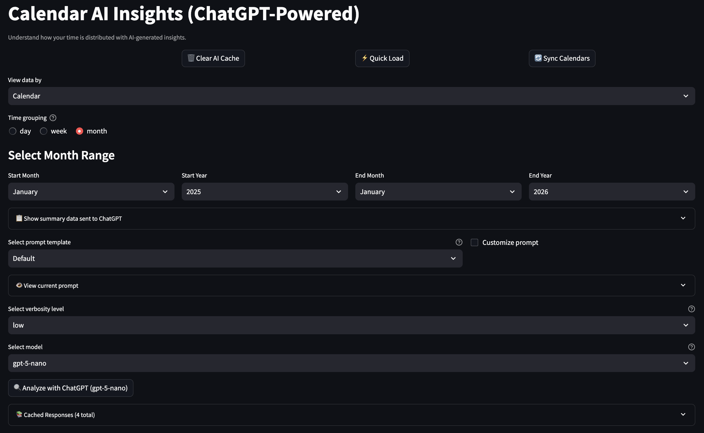

# 🧠 AI Insights

[← README](../../README.md) · [All pages](README.md) · [Configuration](../configuration.md) · [How it works](../how-it-works.md)

A natural-language analysis of your time by ChatGPT. Needs an OpenAI API key, see [Configuration](../configuration.md#openai-ai-insights-only).

## What you get

- **Time grouping**: patterns by day, week or month.
- **Insights**: trends over time, which calendars take the most time, imbalance or overbooking, and simple time-management suggestions.
- **Prompt styles** from `ai_config.json` (detailed, quick summary, productivity focus, …), optionally editable on the page.
- **Model and verbosity**: choose the GPT model and low, medium or high detail.
- **Saved answers**: responses are saved in `ai_responses_cache.json`, survive restarts, and earlier analyses stay browsable.

## What's sent

Only aggregated hours per calendar or category and period, with their names, plus the prompt. Event titles aren't sent.
