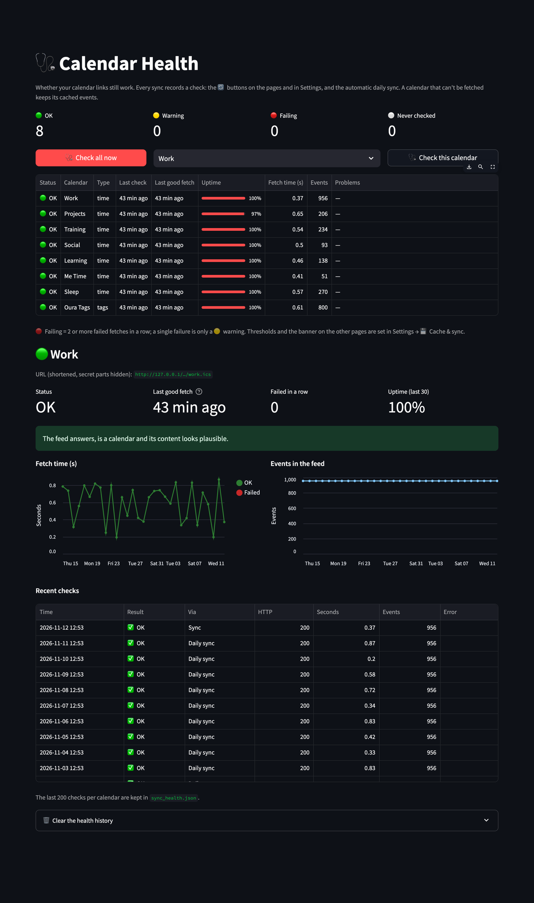

# 🩺 Calendar Health

[← README](../../README.md) · [All pages](README.md) · [Configuration](../configuration.md) · [How it works](../how-it-works.md)

Whether your calendar links still work, before missing events show up in your numbers.

## What's checked

Every fetch records one check per calendar: the 🔄 Sync buttons on the pages and in Settings, the automatic daily sync, and the 🩺 Check buttons on this page.

- **Does the URL answer?** Timeouts, unknown servers, SSL errors, refused connections and HTTP errors are told apart, with hints such as "404: the secret link may have been reset".
- **Is it a calendar?** Not a login or sharing web page, not empty.
- **Can it be read?** Broken feeds, and how many events had to be skipped.
- **Content**: number of events, fetch time, and when anything in the feed last changed (`LAST-MODIFIED`).

## Status

- 🟢 **OK**
- 🟡 **Warning**: a single failed fetch, a sudden drop in events or an empty feed, unreadable events, a slow server, a feed where nothing changed for weeks, or no check for a while.
- 🔴 **Failing**: several failed fetches in a row. The calendar keeps its cached events, and every page shows a banner.
- ⚪ **Never checked**: sync or check it once.

## What you see

- Counts per status, **🩺 Check all now** and **🩺 Check this calendar** (both also sync the events).
- An overview table: last check, last good fetch, uptime over the last 30 checks, fetch time, events and problems.
- Per calendar: failures in a row and since when, charts of fetch time and event count, and the recent checks with their errors.

## Settings and privacy

- Thresholds (failures before 🔴, event drop in %, days without changes, slow fetch, hours without a check) and the banner are in [Settings → 💾 Cache & sync](settings.md#-cache--sync).
- URLs are stored and shown shortened, without the secret part (`https://calendar.google.com/…/basic.ics`). The checks are kept in `sync_health.json`, the last 200 per calendar.
