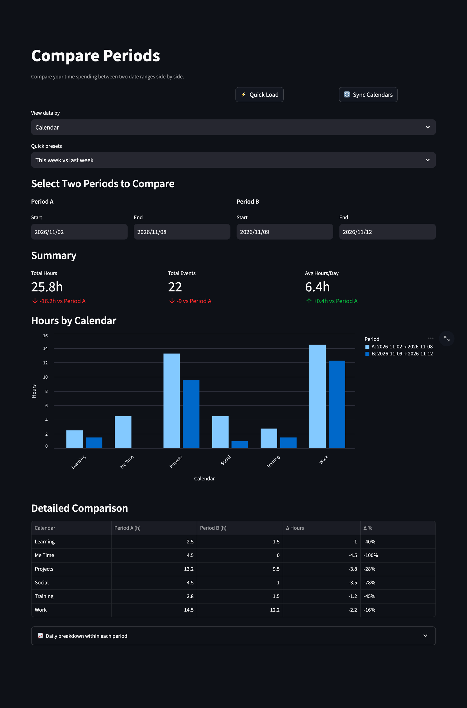

# ⚖️ Compare Periods

[← README](../../README.md) · [All pages](README.md) · [Configuration](../configuration.md) · [How it works](../how-it-works.md)

Your time in two date ranges, side by side.

## What you see

- **Quick presets**: this week vs last week, this month vs last month, this month vs the same month last year, or custom ranges.
- **Summary**: total hours, total events and average hours per day, with deltas.
- **Hours by calendar or category** as grouped bars.
- **Detailed comparison**: absolute and percentage changes per calendar or category.
- **Daily breakdown**: daily hours within each period.
