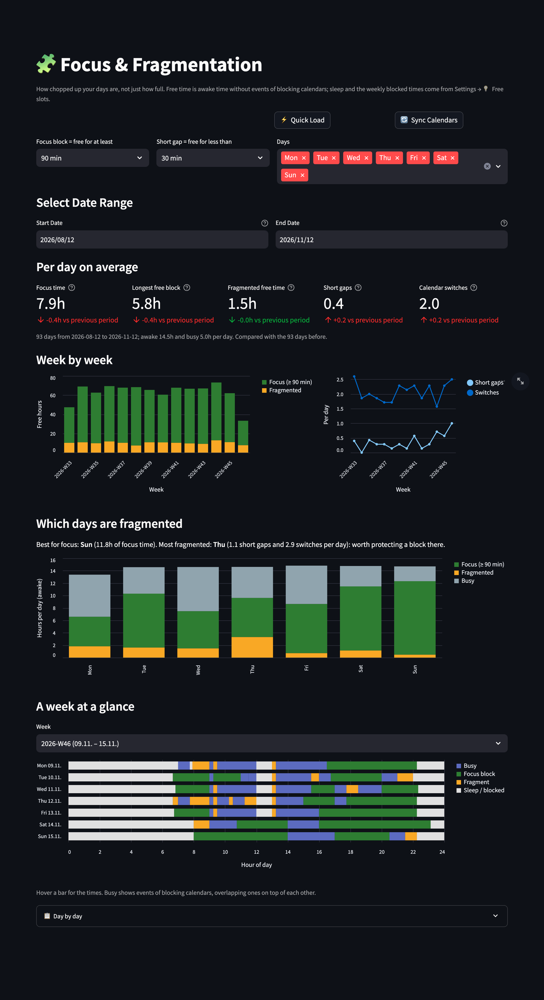

# 🧩 Focus & Fragmentation

[← README](../../README.md) · [All pages](README.md) · [Configuration](../configuration.md) · [How it works](../how-it-works.md)

How chopped up your days are, not just how full they are.

## What you see

- **Per day on average**, compared with the previous period of the same length:
  - **Focus time**: free blocks of at least 90 minutes (adjustable: 45–180 min)
  - **Longest free block**
  - **Fragmented free time**: free time in shorter blocks
  - **Short gaps**: gaps under 30 minutes (adjustable) between two events
  - **Calendar switches**: consecutive events from different calendars
- **Week by week**: focus and fragmented hours, short gaps and switches per day.
- **Which days are fragmented**: focus, fragmented and busy hours per weekday, with the best day for focus and the most fragmented one.
- **A week at a glance**: a timeline per day with busy events, focus blocks, fragments and sleep or blocked times. Hover a bar for the times.
- **Day by day**: the table behind it, with CSV export.

## How free time is defined

Free time is awake time without events of blocking calendars, using the rules from [Settings → 💡 Free slots](settings.md#-free-slots) without the buffer: blocking calendars, busy and free events, the weekly blocked times and sleep. See [How it works](../how-it-works.md#free-time).

- If a calendar looks like a sleep calendar but isn't set as the sleep source, the page says so: otherwise sleep counts as busy time.
- If neither sleep nor a night block is set, the page warns that whole days count as awake time.
- Long timed events, such as a trip stored as one 4-week event, make those days fully busy.

Filter by weekday and date range at the top.
