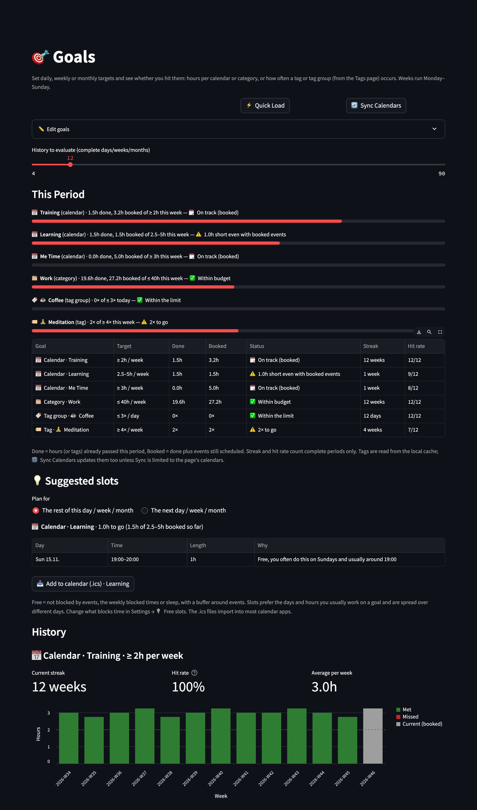

# 🎯 Goals

[← README](../../README.md) · [All pages](README.md) · [Configuration](../configuration.md) · [How it works](../how-it-works.md)

Set targets and see whether you're living the week you intended, with free slots suggested to close the gap.

## Goals

- **Targets**: a **Min**, a **Max** or both, e.g. "Sport ≥ 4h per week" or "Work ≤ 45h per week".
- **What a goal counts**:
  - 📅 a **calendar** or 🗂️ a **category**: hours
  - 🏷️ a **tag** or 🔖 a **tag group** from the [Tags](tags.md) page: how often it occurs, e.g. "☕ Coffee ≤ 2× per day" or "🧘 Meditation ≥ 5× per week". Tag names match the Tags page (variants merged, hidden tags left out); a tag group goal follows the group's current members.
- **Per day, week or month**: weeks run Monday–Sunday.
- **Editing**: open **✏️ Edit goals** and pick the target from one list where every entry shows its type, so a calendar and a category with the same name can't be mixed up. Goals are stored in `goals.json`.

## What you see

- **This period**: done (already passed) vs booked (done plus events still scheduled), with a status: reached, on track, behind, over budget.
- **History**: a bar chart of past periods (met / missed) with the target lines, the current streak, hit rate and average. The history slider sets how many complete periods are evaluated.
- Progress bars for every goal also appear at the top of [Home](home.md), and weekly goals in the [Weekly Review](weekly-review.md).

## 💡 Suggested slots

For every calendar or category goal with a **Min** that booked events don't cover yet, the page suggests free slots that would close the gap:

- in the rest of this day, week or month, or in the next one
- preferring the weekdays and hours you usually spend on that goal, spread over different days
- with a reason for each slot, e.g. "Free, you often do this on Sundays and usually around 19:00"
- as an **.ics download** per goal (or all at once) to import into your calendar app

What counts as busy is set in [Settings → 💡 Free slots](settings.md#-free-slots): blocking calendars, fixed weekly blocks, sleep, slot length, buffer and number of suggestions. If a sleep source is set but no nights are found, the page warns that night-time counts as free.
