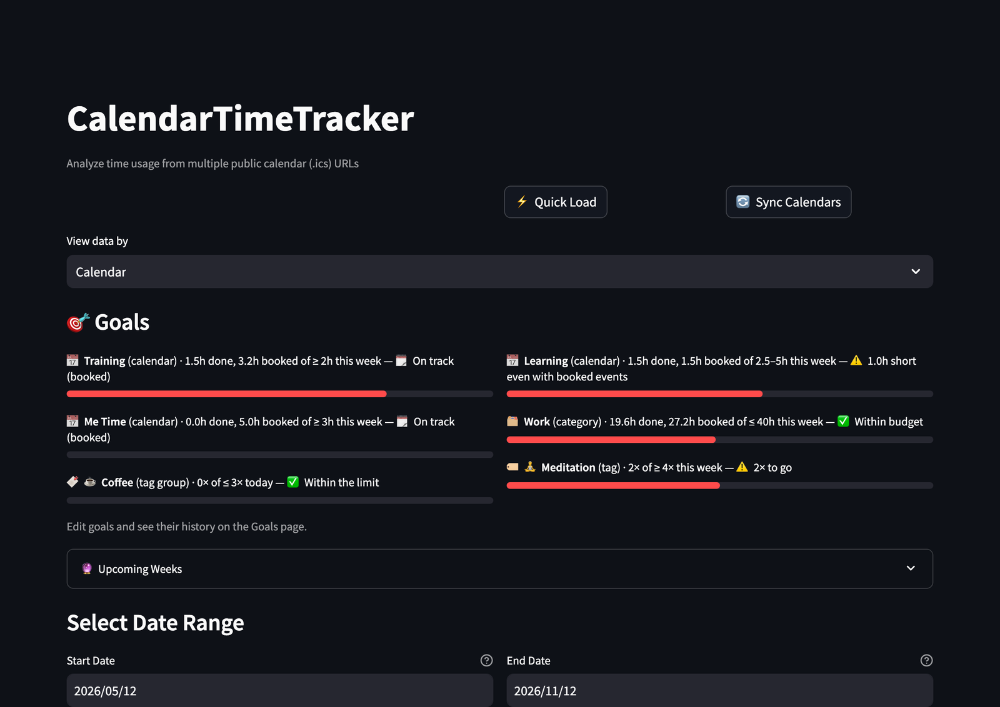
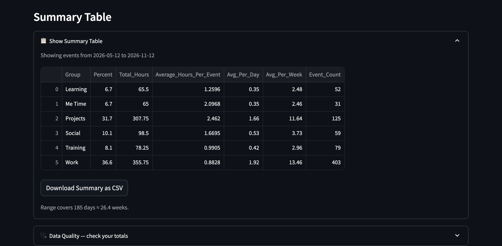
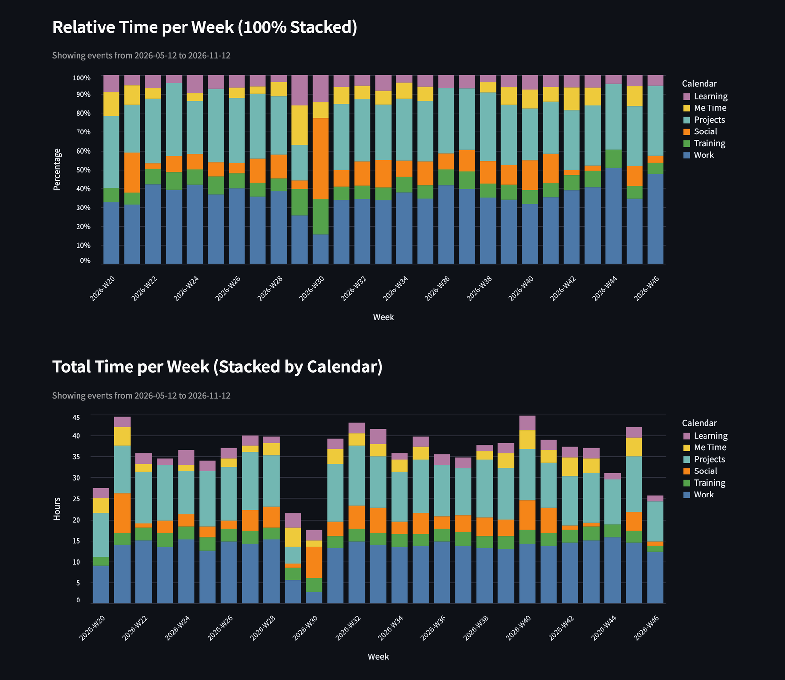
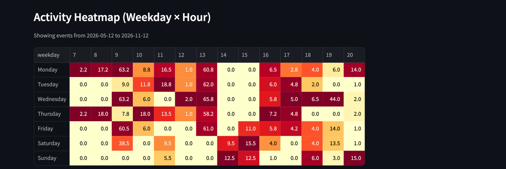
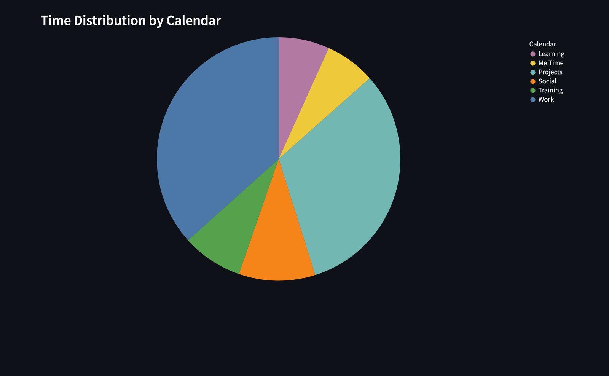
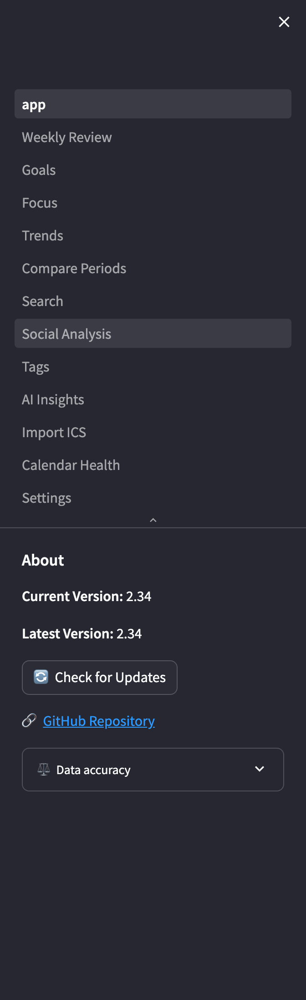

# 🏠 Home

[← README](../../README.md) · [All pages](README.md) · [Configuration](../configuration.md) · [How it works](../how-it-works.md)

The dashboard: how your time splits across calendars or categories, and what's ahead.

## What you see

- **🎯 Goals**: a progress bar per goal for the current day, week or month, see [Goals](goals.md).
- **🔮 Upcoming weeks**: hours already booked for this week and the next three, per calendar or category, next to your typical week (average of the last 8 complete weeks). Weeks above 120% of typical are flagged, so you can rebalance before they happen. Future calendars are usually incomplete, so this is "booked so far", not a prediction.
- **View data by**: switch every chart between **Calendar** and **Category** (categories need `calendars.json`).
- **Date range**: start and end date; the default length is set in Settings → 📊 Data & display.
- **Summary table**: share, total hours, average hours per event, per day and per week, and event count per calendar or category, with CSV export.
- **🩺 Data Quality**: long events in the range, overlapping events grouped by calendar pair, and the total double-counted hours, see [How it works](../how-it-works.md#data-accuracy).
- **Relative and total time**: 100% stacked and stacked bars per day, week or month.
- **Activity heatmap**: hours per weekday and hour.
- **Time distribution**: a pie chart of the whole range.

## Sidebar

The sidebar holds the page navigation, **⚖️ Data accuracy** (how long and free events count, on every page) and the version check with an update button.

## Tips

- **⚡ Quick Load** reads the local cache; **🔄 Sync Calendars** fetches every calendar. Home always syncs all calendars.
- A banner at the top tells you when a calendar can't be fetched, see [Calendar Health](calendar-health.md).
