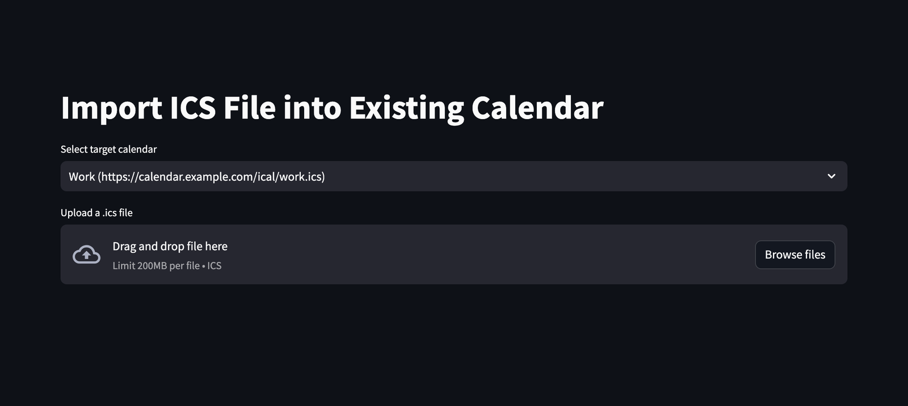

# 📂 Import ICS

[← README](../../README.md) · [All pages](README.md) · [Configuration](../configuration.md) · [How it works](../how-it-works.md)

Add events from an `.ics` file to one of your configured calendars, e.g. an export of older events that the feed no longer contains.

## How it works

- Pick a target calendar (calendars with an `https://` or `file://` URL) and upload the `.ics` file.
- Recurring events in the file are expanded like in a normal sync.
- The events are **added** to the calendar's cache: existing events stay, and only events with the same `UID` are replaced. Older imported events are kept by later syncs like any history older than 30 days, see [How it works](../how-it-works.md#loading-and-sync).
