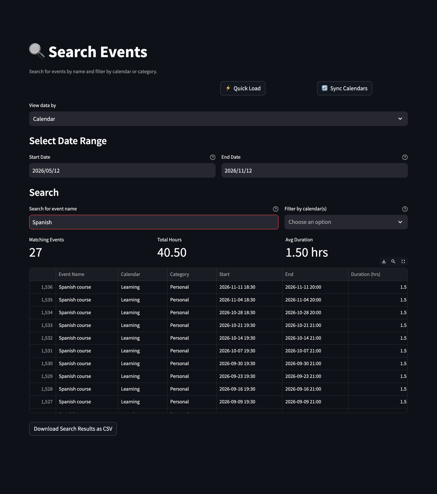

# 🔍 Search

[← README](../../README.md) · [All pages](README.md) · [Configuration](../configuration.md) · [How it works](../how-it-works.md)

Find events by name.

## How to use it

- Type part of an event name. The search ignores case; `*` is a wildcard (`Z*rich` matches "Zürich").
- Limit it to a date range and, optionally, to calendars or categories.
- See every match with start, end and duration, plus the number of events, total hours and average duration.
- Download the results as CSV.
