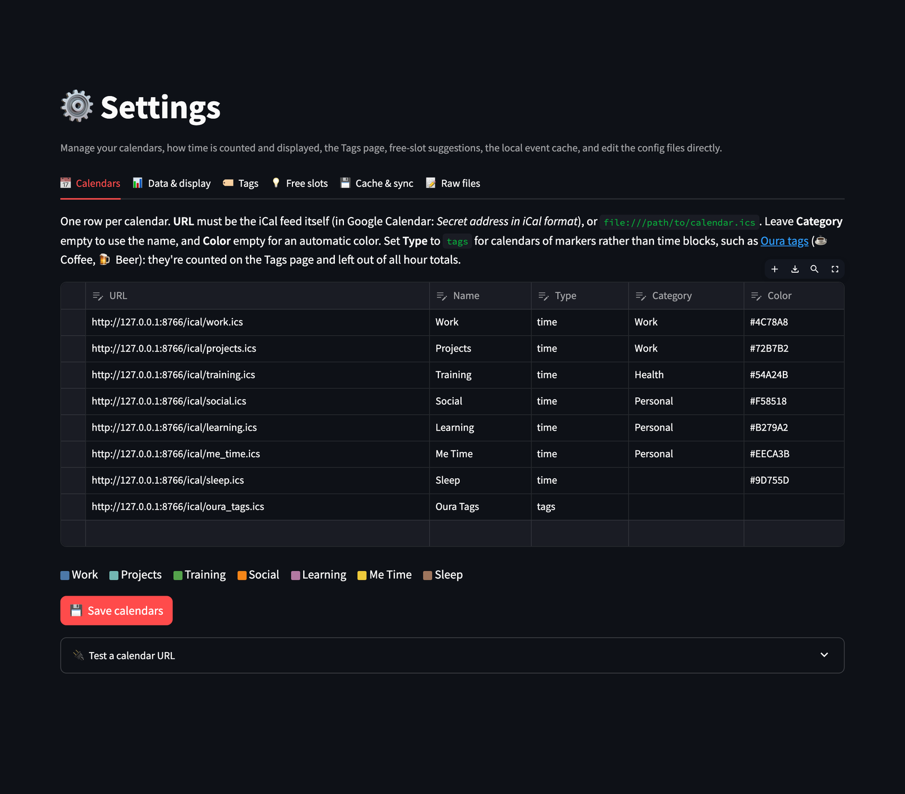
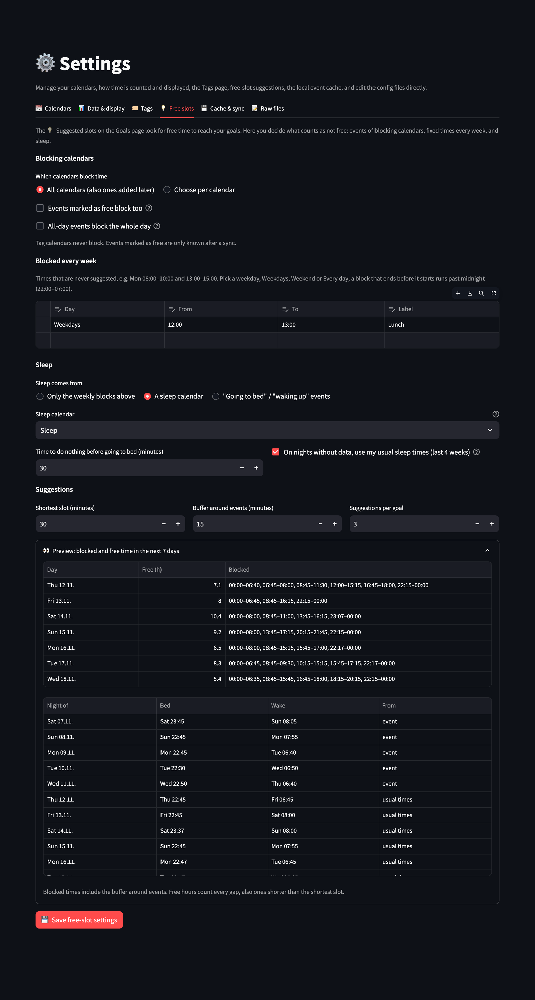

# ⚙️ Settings

[← README](../../README.md) · [All pages](README.md) · [Configuration](../configuration.md) · [How it works](../how-it-works.md)

Manage the app from the browser: forms for the common settings, plus a raw text editor for every config file. Settings are stored in `app_settings.json` unless noted.

## 📅 Calendars

- Add, edit and remove calendars in `calendars.json`: URL, name, type (`time` or `tags`), category and color.
- Checks for missing or duplicate URLs, Google Calendar sharing links and invalid colors. The previous file is kept as `calendars.json.bak`, and keys added by hand are preserved.
- A URL tester checks that a link returns a valid iCal feed.
- Setups that still use `calendars.txt` can be converted in one click.

## 📊 Data & display

- How all-day and multi-day events count (fully, waking hours only, or not at all), and from how many hours an event counts as long. For waking hours only: the hours of night per night, and whether nights your sleep source recorded use that sleep instead.
- Whether events marked as free are ignored.
- The default "View data by" choice and the default date range when a page opens.
- **🎯 Goals**: the default history on the Goals page (in weeks, for every goal), and how sleep goals estimate the nights not recorded yet: your usual sleep (median bedtime and wake-up time of the last 4 weeks), your [go_to_bed](https://github.com/ramhee98/go_to_bed) bedtime plan where it has one (else usual sleep), your usual bedtime with the planned wake-up time, or no estimate. The plan calendar is found automatically by its event IDs, or chosen here. Sleep goals can count **time in bed** (the length of the sleep events, default) or **actual sleep** (the "Sleep: 7:17" in the titles of [oura-sleep-ical](https://github.com/ramhee98/oura-sleep-ical) events; estimated nights then use your usual share of time in bed asleep). Oura activity goals can add your average per weekday or nothing. See [Goals](goals.md).

## 🏷️ Tags

Defaults for the [Tags](tags.md) page: the preselected chart tags (the N most frequent or a fixed list, with a fallback for entries without data), keeping your chart selection, the initial view and "Count per", a separate date range, preselected tag calendars, hidden tags, and merging emoji variants.

## 💡 Free slots

What counts as busy for the suggested slots on the [Goals](goals.md) page and for the [Focus](focus.md) page.

- **Blocking calendars**: all calendars (also ones added later), or per calendar whether it blocks and whether its events marked as *free* block too (otherwise only *busy* events do). Also whether calendars added later block, and whether all-day events block the whole day. Tag calendars never block.
- **Blocked every week**: fixed times per weekday, e.g. Mon 08:00–10:00 and 13:00–15:00, or for Weekdays, Weekend or Every day. A block that ends before it starts runs past midnight (night 22:00–07:00). Rows add up: a Weekdays row and a Friday row both apply on Fridays.
- **Sleep**: from a sleep calendar, from a sleep calendar plus a bedtime plan ([go_to_bed](https://github.com/ramhee98/go_to_bed): nights not recorded yet use the planned bedtime and wake-up time, and neither calendar counts as busy), or from events whose name contains e.g. "going to bed" (sleep start) and "waking up" (sleep end) or a fixed wake-up time per weekday. Optional time to do nothing before going to bed (e.g. 30 min). Nights without data (like future ones) use your usual sleep times of the last 4 weeks; sleeps under 3 hours count as naps.
- **Suggestions**: shortest slot, buffer around events and suggestions per goal.
- **👀 Preview**: blocked and free time of the next 7 days and the detected nights, updated as you edit.

## 💾 Cache & sync

- Cached events, date range and last update per calendar, with a hint for calendars that look like tag calendars.
- Sync one or all calendars, clear one calendar's cache, and delete cache files left behind by removed calendars, individually or all at once.
- Whether 🔄 Sync Calendars on a page fetches all calendars (default) or only those the page shows. Home always syncs all calendars.
- **🩺 Calendar health checks**: the thresholds of the [Calendar Health](calendar-health.md) page and the banner.

## 📝 Raw files

- Edit `calendars.json`, `calendars.txt`, `app_settings.json`, `goals.json`, `tag_groups.json`, `social_analysis_settings.json` and `ai_config.json` as text.
- JSON is checked before saving. In `app_settings.json`, the free-slot keys (`slots_*`) are checked in detail: valid days and `HH:MM` times, known modes, numbers in range and no misspelled keys.
- The previous version is kept as `<file>.bak` and can be loaded back; JSON can be reformatted.
- `.env` with the OpenAI key is not shown.
