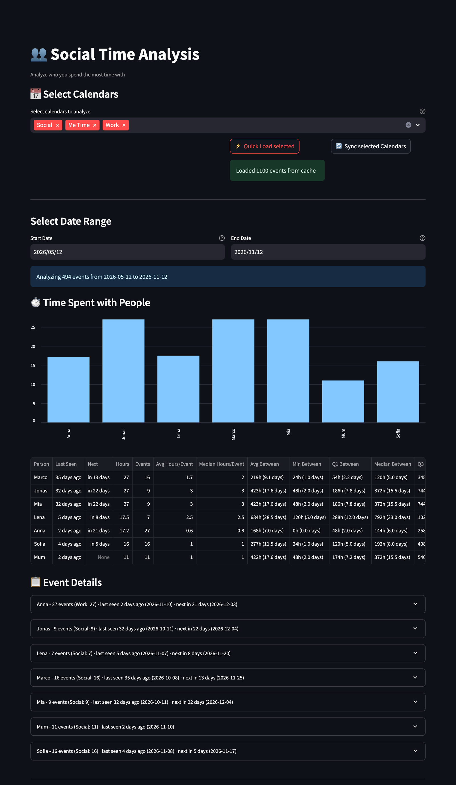

# 👥 Social Analysis

[← README](../../README.md) · [All pages](README.md) · [Configuration](../configuration.md) · [How it works](../how-it-works.md)

Who you spend the most time with, based on event titles.

## How to use it

1. **Select calendars** to analyze and press ⚡ Quick Load selected (or 🔄 Sync selected Calendars).
2. **Track people** in the sidebar: add names, with comma-separated aliases or nicknames (e.g. "Niclas, Nic"). **Quick Add** adds a person without editing the sidebar list.
3. **Discover people**: frequent words in your event titles, to find names you haven't added yet. Hide irrelevant words from this list without excluding their events.

## What you see

- **Time spent with people**: hours per person.
- **Statistics per person**: hours, events, average and median hours per event, when you last met and when you meet next.
- **Meeting cadence**: the time between consecutive events with each person as a five-number summary (average, min, Q1, median, Q3, max), in hours with days in parentheses.
- **Event details** per person, and **sample events** that no tracked person matched, to spot names you're still missing.

## Options

- **Ignore partial names**: "john" doesn't match "john doe" when both are tracked.
- **Calendars named after a person**: if a calendar's name matches a tracked person or alias, every event in it counts for them (events whose title also names them still count once).
- **Exclude patterns**: leave out generic events like "team meeting".
- All settings are saved in `social_analysis_settings.json` (sorted alphabetically). Tag calendars are never analyzed.
