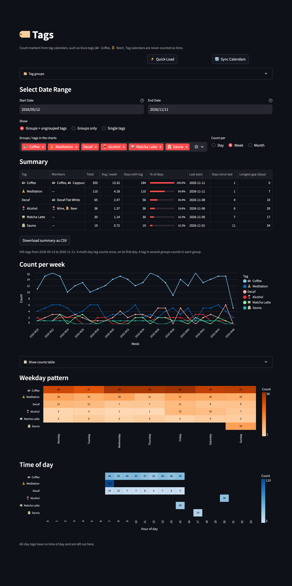

# 🏷️ Tags

[← README](../../README.md) · [All pages](README.md) · [Configuration](../configuration.md) · [How it works](../how-it-works.md)

Counts of markers from [tag calendars](../configuration.md#tag-calendars), such as Oura tags exported with [oura-tags-ical](https://github.com/ramhee98/oura-tags-ical) (☕ Coffee, 🍺 Beer, 🧖 Sauna). Tags are never counted as time.

## What you see

- **Summary per tag**: total, average per week, days with the tag and share of days, last seen, days since last (the current streak without it, e.g. 12 alcohol-free days) and the longest gap in the range, with CSV export.
- **Count per day, week or month** for the selected tags.
- **Weekday pattern**: which days a tag is logged on.
- **Time of day**: when timed tags happen (e.g. coffee after 14:00). All-day tags have no time and are left out.
- Monthly "📊 Tag Summary" events from oura-tags-ical are ignored, and a multi-day tag counts once, on its first day.

## 🗂️ Tag groups

Combine tags, e.g. every coffee type into ☕ Coffee, or 🍷 Wine and 🍺 Beer into Alcohol.

- **Members**: pick tags, and/or add **keywords** that match tag names exactly, ignoring case and the emoji: `Flat White` matches ☕️ Flat White but not ☕️ Decaf Flat White. A keyword that is just an emoji, like `☕`, matches every tag starting with it, including coffee types you log in the future.
- **💡 Suggest from emojis** creates one group per emoji shared by several tags. **🔤 Suggest from names** creates one group per word or phrase shared by several tag names (e.g. Decaf, Flat White), with the matching tag names as keywords.
- A tag may be in several groups (e.g. Coffee and Decaf) and then counts in each.
- **Weights**: how much a tag counts in a group, matched like keywords, e.g. `Flat White=2, Doppio=2, Decaf Flat White=0` in ☕ Coffee counts shots: a flat white or doppio counts 2, a decaf 0, every other member 1. A weight keyed by an emoji (`☕=1.5`) applies to members without their own weight. Group totals, averages, trend and pattern charts, and tag group goals add up the weights; single tags always count 1. Days with only weight-0 tags count as days without the group (e.g. for "Days since last"). The matched tags are listed with their weight (☕️ Flat White ×2).
- **Show**: groups with the remaining single tags, groups only, or single tags only.
- Groups are stored in `tag_groups.json` and can be used as [goals](goals.md).

## Your defaults

In [Settings → 🏷️ Tags](settings.md):

- which tags or groups the charts start with: the N most frequent (8 by default) or a fixed list
- whether your chart selection is kept when you switch view or date range
- the initial view and "Count per", and a separate date range
- preselected tag calendars and hidden tags
- merging tags that differ only in the emoji variant (☕ / ☕️) or spacing
