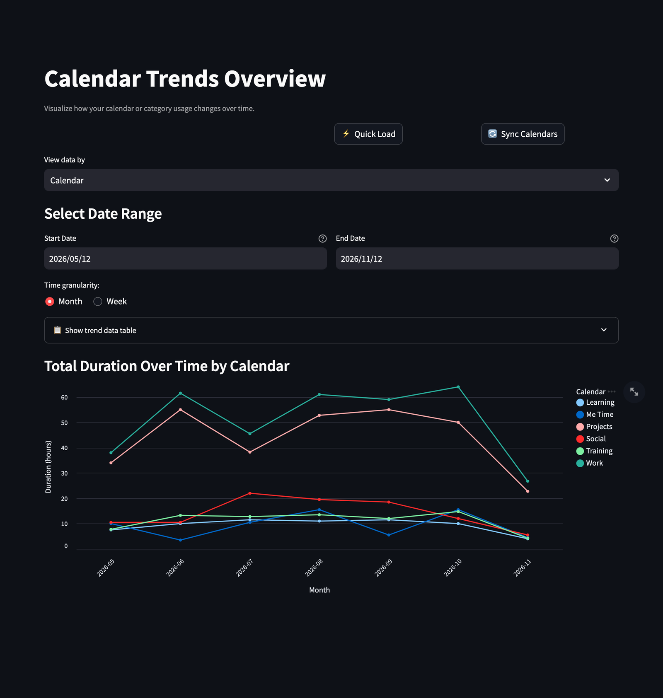

# 📈 Trends

[← README](../../README.md) · [All pages](README.md) · [Configuration](../configuration.md) · [How it works](../how-it-works.md)

How your calendar activity evolves over time.

## What you see

- Total hours per calendar or category as an interactive line chart, per **week** or **month**.
- An expandable table with the per-period totals.
- Useful for spotting workload peaks and recurring patterns.

The ⚖️ Data accuracy rules in the sidebar apply, see [How it works](../how-it-works.md#data-accuracy).
