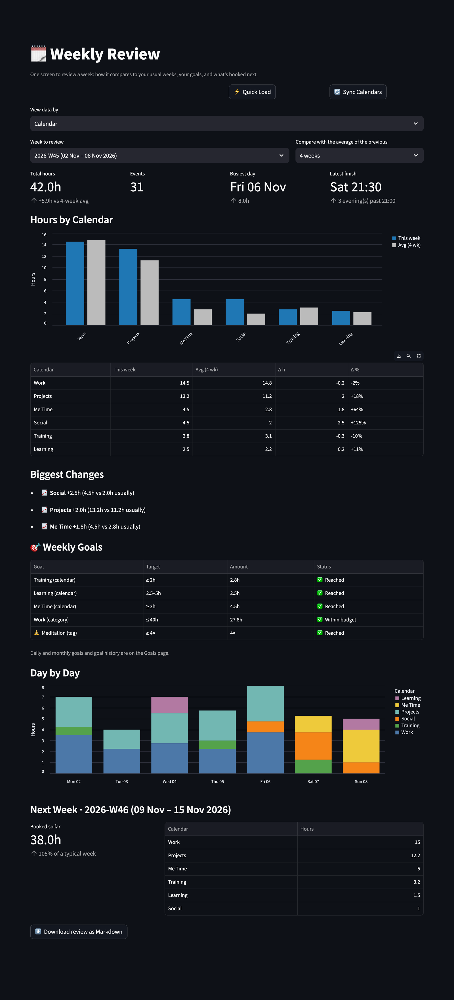

# 🗓️ Weekly Review

[← README](../../README.md) · [All pages](README.md) · [Configuration](../configuration.md) · [How it works](../how-it-works.md)

A one-screen weekly ritual instead of comparing four pages by eye.

## What you see

- **Week picker**: defaults to the last complete week; the current week is marked as in progress.
- **Headline metrics**: total hours compared with the average of the previous 4, 8 or 12 weeks, event count, busiest day, latest finish and evenings past 21:00.
- **Hours by calendar or category** next to your usual week, with the biggest changes called out.
- **🎯 Weekly goals**: the status of every weekly goal (time and tag goals) for that week. Daily and monthly goals are on the [Goals](goals.md) page.
- **Day by day**: stacked hours per day.
- **Next week**: hours already booked compared with a typical week.
- **Markdown export**: download the review. It contains aggregates only, no event titles.
